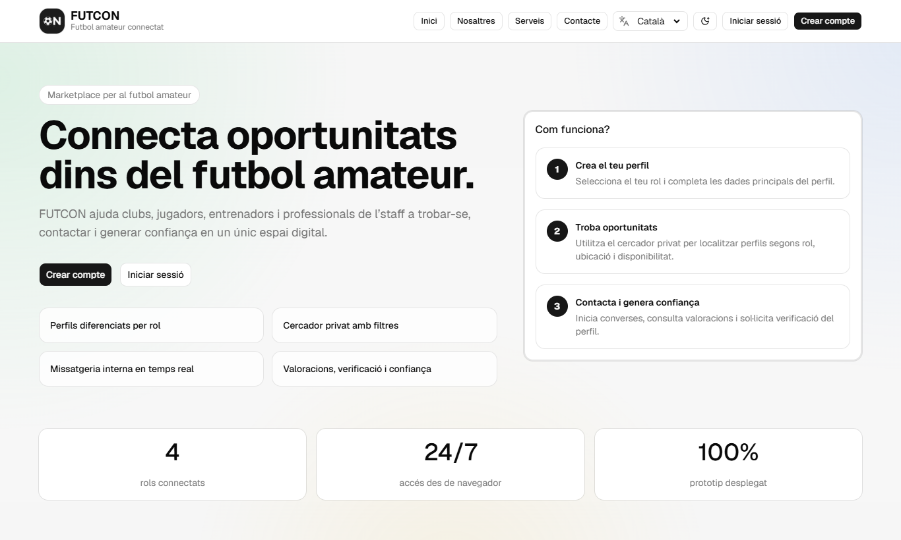
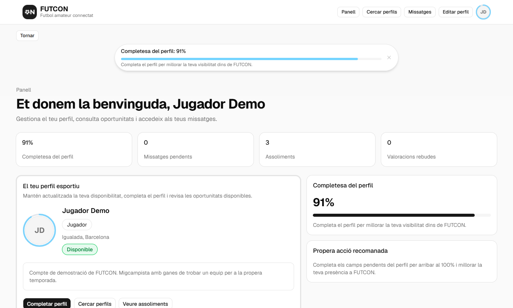
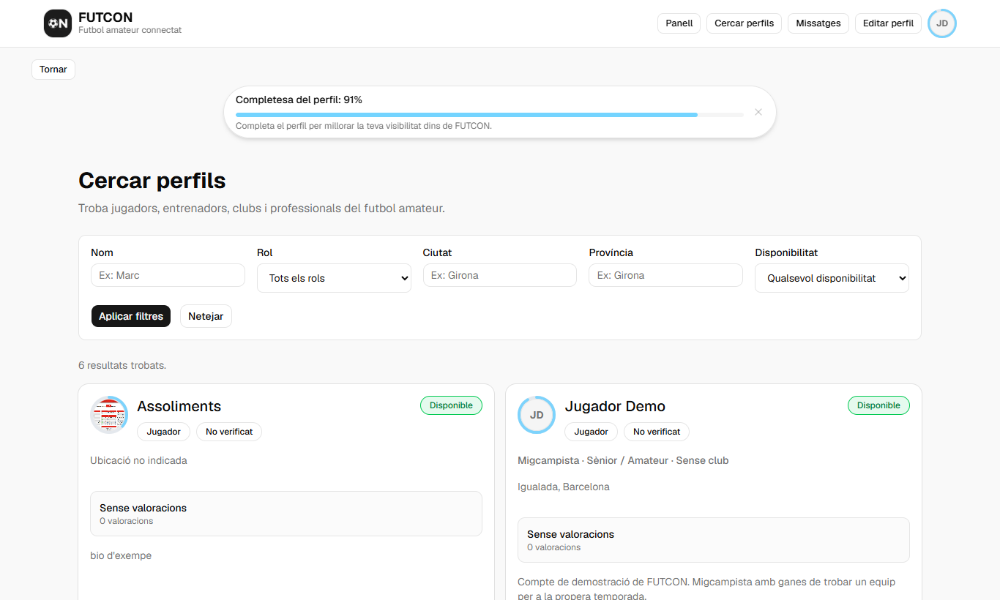
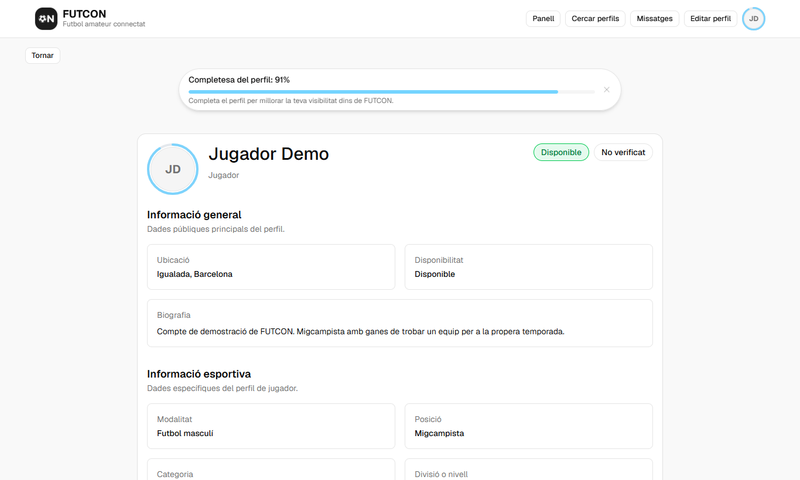
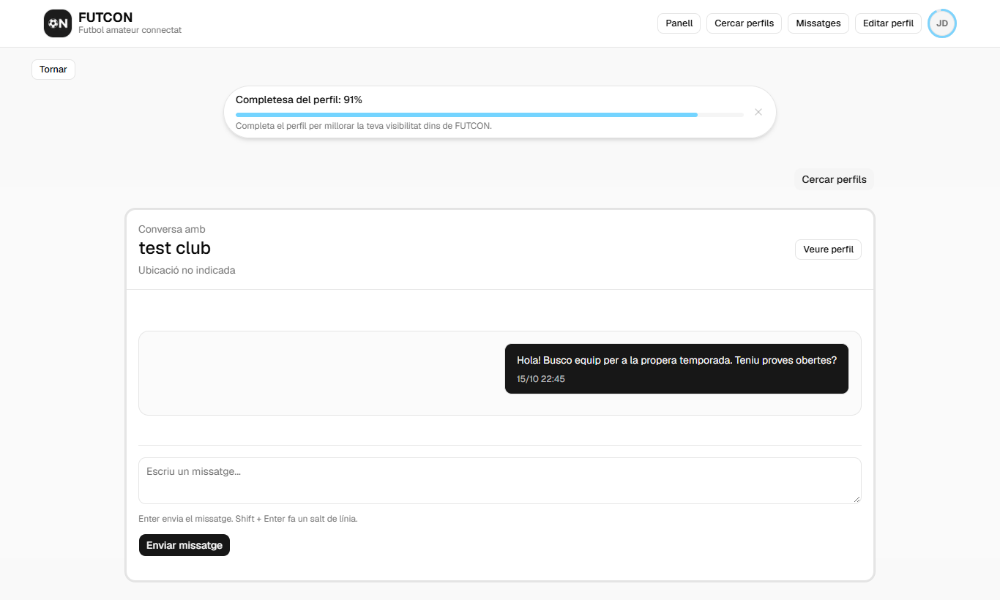
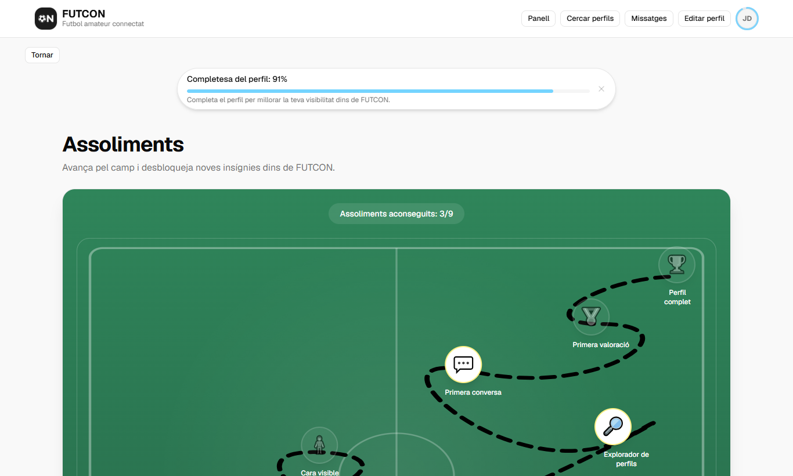
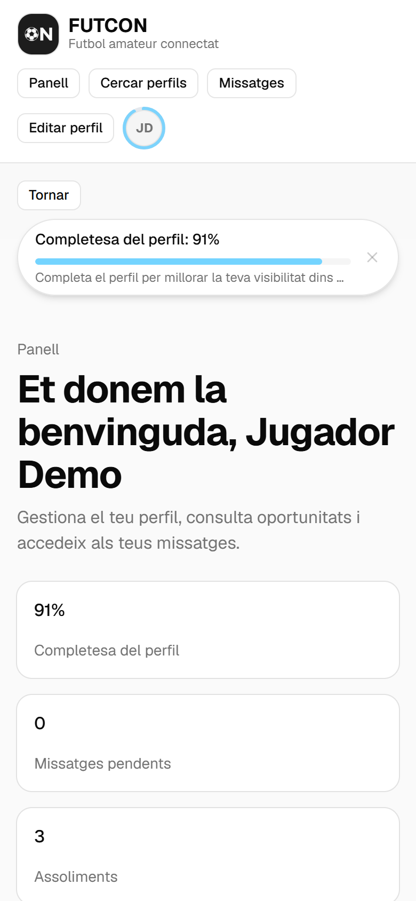

# FUTCON

**Marketplace per al futbol amateur.** FUTCON connecta jugadors, entrenadors, clubs i professionals de l'staff perquè es puguin trobar, contactar i generar confiança en un únic espai digital.

Projecte desenvolupat com a Treball de Final de Grau.

🔗 **Demo:** [futcon.vercel.app](https://futcon.vercel.app)

### Compte de demostració

Per provar l'aplicació sense registrar-te:

| Correu | Contrasenya |
| --- | --- |
| `demo.futcon@example.com` | `FutconDemo2026` |

> És un compte compartit amb rol de jugador i sense permisos d'administració. Les dades que s'hi introdueixin són visibles per a altres usuaris de la demo.



## Funcionalitats

- **Perfils per rol**: jugador, entrenador, club o staff, cadascun amb camps esportius propis (modalitat, categoria, divisió, club, llicència…), foto de perfil i indicador de completesa.
- **Cercador de perfils** amb filtres per nom, rol, ciutat, província i disponibilitat.
- **Xat en temps real** entre usuaris amb Supabase Realtime: comptador de no llegits, marcar com a llegit/no llegit, amagar i eliminar converses.
- **Valoracions** entre perfils amb puntuació mitjana.
- **Assoliments**: sistema de gamificació amb insígnies que es desbloquegen en completar el perfil, fer la primera cerca, enviar el primer missatge, etc., presentats sobre un mapa en forma de camp de futbol.
- **Panell d'administració**: cerca d'usuaris, bloqueig i desbloqueig de comptes i enviament d'advertències de moderació.
- **Tres idiomes**: català, castellà i anglès.
- **Tema clar i fosc.**
- **PWA** instal·lable (manifest i service worker) i disseny responsive.
- **Autenticació** amb correu i contrasenya o amb Google.

## Captures

| Panell | Cercador |
| --- | --- |
|  |  |

| Perfil públic | Xat |
| --- | --- |
|  |  |

| Assoliments | Mòbil |
| --- | --- |
|  |  |

## Stack

| Capa | Tecnologia |
| --- | --- |
| Framework | [Next.js 16](https://nextjs.org) (App Router, Server Components, Server Actions) |
| UI | React 19, TypeScript, Tailwind CSS 4, components de [shadcn/ui](https://ui.shadcn.com) (Radix UI), Lucide |
| Backend | [Supabase](https://supabase.com): PostgreSQL, Auth, Realtime i Storage |
| Seguretat | Row Level Security (RLS) a PostgreSQL i funcions RPC per a les operacions sensibles |
| Desplegament | Vercel |

## Estructura

```
src/
├── app/          # Rutes (App Router) i Server Actions per pàgina
├── components/   # Components per domini: profiles, conversations, achievements, layout, ui…
├── lib/          # Lògica compartida: clients de Supabase, i18n, assoliments, completesa del perfil…
└── proxy.ts      # Refresc de la sessió de Supabase a cada petició
```

## Execució en local

Requisits: Node.js 20 o superior, [pnpm](https://pnpm.io) i un projecte de Supabase amb l'esquema de l'aplicació.

1. Clona el repositori i instal·la les dependències:

   ```bash
   git clone https://github.com/nigelboada/FUTCON.git
   cd FUTCON
   pnpm install
   ```

2. Crea un fitxer `.env.local` a l'arrel amb les variables del teu projecte de Supabase:

   ```bash
   NEXT_PUBLIC_SUPABASE_URL=https://<projecte>.supabase.co
   NEXT_PUBLIC_SUPABASE_ANON_KEY=<anon key>
   SUPABASE_SERVICE_ROLE_KEY=<service role key>
   NEXT_PUBLIC_SITE_URL=http://localhost:3000
   ```

3. Arrenca el servidor de desenvolupament i obre [http://localhost:3000](http://localhost:3000):

   ```bash
   pnpm dev
   ```

Altres scripts: `pnpm build` (build de producció), `pnpm start` (servir el build) i `pnpm lint`.

## Autor

**Nígel Boada** · [GitHub](https://github.com/nigelboada)
